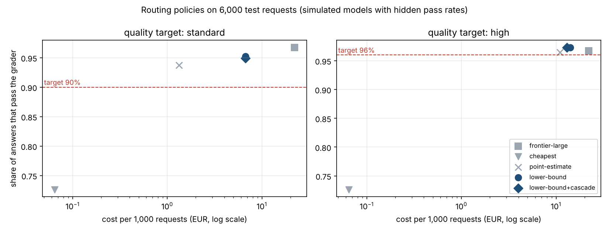

# model-router-platform

**One API in front of closed providers and open-weight models. Each request goes to the cheapest
model *proven* to meet its quality target, every provider call is accounted exactly once, and
workspaces, keys and content are kept apart by the database, not by convention.**

Built on the stack of a small team bringing a multi-model product to production: Python, FastAPI,
Pydantic and LiteLLM; PostgreSQL with row-level security and pgvector; Redis and arq;
OpenTelemetry; pytest and testcontainers; Terraform on Scaleway with Kubernetes for GPU serving.

| Area | What is here |
|---|---|
| **Gateway and routing** | OpenAI-compatible `/v1/chat/completions` with streaming; retries with backoff on retryable errors only; fallbacks before the first token, never after; provider errors classified once ([app.py](src/mrp/app.py), [providers](src/mrp/providers)) |
| **Model selection** | task classification; a quality table of *measured* pass rates per task and model; the cheapest model whose 95% lower bound meets the target; cheap-first cascades only where a check makes it safe; a health monitor that takes degrading models out of rotation ([router.py](src/mrp/router.py), [health.py](src/mrp/health.py)) |
| **Cost optimisation** | exact cache, semantic cache (pgvector) with a strict meaning check, history compression; savings recorded as *estimates*, never mixed with spend ([cache.py](src/mrp/cache.py)) |
| **Usage and billing** | idempotent ledger, every provider call recorded before it is made, plan entitlements, usage reports, a reconciler for lost calls, invoice reconciliation per request or per day ([ledger.py](src/mrp/ledger.py), [reconcile.py](src/mrp/reconcile.py)) |
| **Agent infrastructure** | runs with checkpoints, leases, cost limits, human approval for external effects, tool calls once per idempotency key, executed by arq workers ([agents.py](src/mrp/agents.py), [worker.py](src/mrp/worker.py)) |
| **Tenancy and secrets** | row-level security on every workspace table; customers' provider keys envelope-encrypted with workspace-bound associated data; KMS rotation without decrypting secrets; logs and traces without content or keys ([001_schema.sql](src/mrp/sql/001_schema.sql), [secrets.py](src/mrp/secrets.py)) |
| **European infrastructure** | Terraform for Scaleway (Kapsule with a CPU pool and an autoscaled L4 GPU pool, HA PostgreSQL, TLS Redis, Key Manager, Secret Manager, all on a private network); Kubernetes manifests for gateway, worker and vLLM, hardened and network-policed ([infra](infra)) |
| **Agentic engineering** | `AGENTS.md`, invariant tests that run first, a one-command check loop, per-task worktrees with isolated test databases ([docs/AGENTIC-ENGINEERING.md](docs/AGENTIC-ENGINEERING.md)) |

## Results

From `mrp evaluate` ([reports/EVALUATION.md](reports/EVALUATION.md)); CI reruns it and `mrp gate`
fails the build when an objective is missed.



**Routing** (6,000 test requests over six task types, eight simulated models with hidden pass rates):

| Target | Policy | Quality | Tasks clearly below target | Cost / 1k requests | vs. always-frontier |
|---|---|---|---|---|---|
| 90% | always the frontier model | 96.8% | none | €22.11 | — |
| 90% | lower bound + cascade | 94.9% | **none** | **€6.68** | **70% cheaper** |
| 90% | point estimates | 93.8% | reasoning (87%) | €1.33 | 94% cheaper, but misses |
| 96% | lower bound + cascade | 97.3% | reasoning | €12.99 | 41% cheaper |

- At the 96% target no model is proven on reasoning, the frontier model included (94% on the test
  set); the router says so in its route explanation instead of pretending.
- Reading point estimates instead of lower bounds is what makes cheap routing *look* good: with only
  30 calibration items per cell it puts summarisation and reasoning clearly below target.
- **Drift:** when the cheap fine-tuned extraction model degrades mid-stream, the health monitor takes
  it out of rotation and quality holds at 93–95% instead of falling to 86–89%, with no false exclusions
  over 6,000 healthy requests.

**Billing under failure** (1,500 requests through the real gateway on PostgreSQL and Redis): 97
provider errors (42 after charging), 42 gateway crashes between a provider's answer and the ledger,
47 clients disconnecting mid-stream, 80 duplicate requests and 42 retries.

| Check | Result |
|---|---|
| Provider charges missing from the ledger, after reconciliation | **0 of 1,627** |
| Ledger costs differing from what the provider charged | **0** |
| Requests billed twice / billed a wrong amount / billed without an answer | **0 / 0 / 0** |
| Planted invoice errors found (overbilled, missing, not ours) | **all** |

**Semantic cache** (600 repeats and 600 near misses: one amount, country, product, date or negation
changed): at similarity 0.85 it serves **90.8% of repeats and 0% of near misses**; without the
meaning check it would serve 58.8% of near misses. The first version of the check, on numbers and
capitalised names, served 38.5% of repeats and still 12% of near misses.

**Gateway overhead** (one process, providers answering instantly): p50 **9.6 ms**, p95 **13.3 ms**
at concurrency 1, with five short database transactions per request; 176 requests/s at concurrency 16 on a 2-vCPU
machine shared with PostgreSQL, Redis and the load generator.

### What the tests and evaluations caught while building it

The pool could silently drop row-level security (asyncpg's `RESET ALL` resets `SET ROLE`); a cache
hit could bypass idempotency; Python and PostgreSQL rounded money differently; a 95% test repeated
after every answer took healthy models out of rotation; untyped SQL parameters billed a cut-off stream
zero. Each is fixed and guarded by a test. Details in
[docs/AGENTIC-ENGINEERING.md](docs/AGENTIC-ENGINEERING.md).

## Run it

```bash
docker compose -f deploy/docker-compose.yml up --build -d     # gateway, worker, PostgreSQL (pgvector), Redis
deploy/smoke.sh                                              # workspace, routing, replay, cache, stream, agent run, usage
```

```bash
pip install -e ".[dev]"
export MRP_DATABASE_URL=postgresql://... MRP_REDIS_URL=redis://... MRP_ADMIN_TOKEN=... MRP_KEKS="v1:$(openssl rand -base64 32)"
mrp serve                                  # MRP_PROVIDERS=litellm for real providers, sim for simulated ones
arq mrp.worker.WorkerSettings              # agent runs and the reconciler
scripts/check.sh                           # format, lint, types, invariants, tests
mrp evaluate && mrp gate
```

```bash
curl localhost:8000/v1/chat/completions -H "Authorization: Bearer $KEY" -H "Idempotency-Key: 42" \
  -d '{"model": "auto", "messages": [{"role": "user", "content": "Extract the invoice id as JSON: INV-9"}],
       "mrp": {"quality": "high", "max_cost": 0.01}}'
# x-mrp-task: extraction · x-mrp-model: … · x-mrp-route: why · x-mrp-estimated-cost · x-mrp-actual-cost · x-mrp-billed
```

## Layout

```
src/mrp/
  app.py            the API: auth, routing, cache, retries, fallbacks, streaming, BYOK, agent runs, admin
  router.py         task classification, quality table, lower-bound routing, cascades, cheap checks
  health.py         production drift detection per task and model
  ledger.py         idempotent usage ledger, entitlements, settlement, usage reports
  reconcile.py      lost-call settlement and invoice reconciliation
  cache.py          exact and semantic cache, meaning check, history compression
  agents.py         checkpointed, leased, budgeted agent runs with approvals
  secrets.py        envelope encryption (local KMS and Scaleway Key Manager), redaction
  providers/        LiteLLM adapter and the simulated model pool
  sql/              schema with row-level security
  eval/             routing, billing chaos, cache and overhead evaluations
infra/terraform/    Scaleway: Kapsule + GPU pool, PostgreSQL, Redis, Key Manager, Secret Manager
infra/k8s/          gateway, worker, vLLM, migrations job, network policies
docs/               architecture and failure modes, agentic engineering, runbook, decisions
```

## Limits

- **Simulated models.** Routing results measure the router's logic against a known truth; real
  savings depend on real models' pass rates on a customer's tasks, which is why the quality table is
  measured (`mrp calibrate`), never configured. The LiteLLM adapter is tested with LiteLLM's mock
  responses, not live accounts.
- **Infrastructure is validated, not applied.** CI runs `terraform validate` and checkov on Terraform
  and Kubernetes; nothing has been deployed to a Scaleway account. The Key Manager adapter is tested
  against recorded responses.
- **Not built:** request decomposition across models, the fine-tuning pipeline, real Gmail / Slack /
  calendar connectors, the Next.js frontend, Langfuse and Sentry integrations (OpenTelemetry is wired).
- The semantic cache uses a hashing embedder (no model download); a sentence-embedding model plugs in
  behind the same interface, and its threshold must be re-measured.
